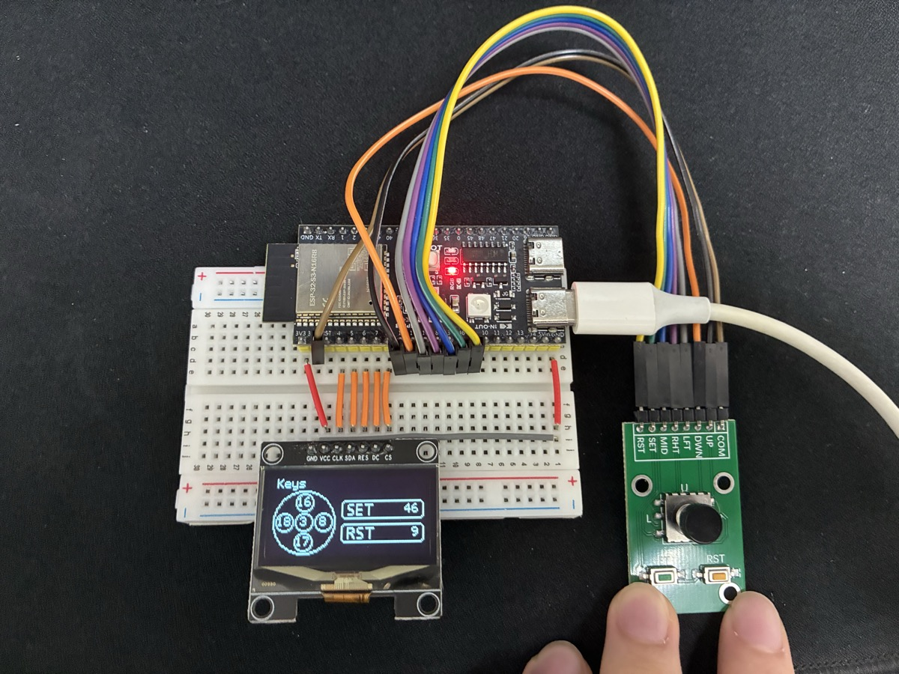
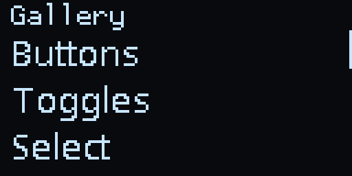

# lilt

给 TinyGo 用的 GUI 框架，手感参照 osu!framework 和 iOS：所有会动的东西都由弹簧驱动，按下有反馈，松手才触发。框架与硬件无关，屏幕和按键都是接口，单色、彩色屏都能接。模块路径是 `github.com/chhongzh/lilt`。





上图由 `go run ./cmd/preview -highlight` 在主机上录制，跑的是和固件同一份 gallery 代码。

文档：<https://chhongzh.github.io/lilt/>。设计需求见 [DESIGN.md](DESIGN.md)。

## 包

```
lilt      Start、Pause、Stop：启动和停止 UI goroutine
anim      弹簧动画 Value 与全局调度器
gfx       Screen 接口、带裁剪和平移的 Canvas、字体
ui        节点树、布局（Flex / Grid / Stack）、页面与弹窗的层栈、焦点、输入、光标、主题
widget    Label、List、Scroll、Button、CheckBox、Radio、Select、Chip、Choice、Toggles、Input、
          Drawer、Dialog、Toast、软键盘
driver    SH1106 驱动（待重写）；desktop 桌面窗口（也能编成 wasm）；silent 只画进内存、输出图片和 GIF
examples  gallery 演示，以及跑 gallery 的 ESP32-S3 固件（esp32s3-generic）
cmd       preview：在主机上按脚本回放一段操作，输出 GIF 和截图拼图
          sim：在桌面窗口或浏览器里跑 gallery
```

除了 `driver`，这些包都不 import `machine`，主机上可以直接编译和预览。

## 接入一块屏幕

驱动实现 `gfx.Screen` 即可；能反色的屏再实现 `gfx.Inverter`，光标会改成反色绘制。实现了 `drivers.Displayer`（`Size`、`SetPixel`、`Display`）的 tinygo 驱动可以直接用 `gfx.FromDisplayer` 包一层。驱动自带 `FillRectangle` 时用它填充，没有就逐点画。想要反色光标或更快的填充，可以自己写适配器（参考 [examples/esp32s3-generic/main.go](examples/esp32s3-generic/main.go)）。

```go
lilt.Start(screen, home) // 之后 UI 在自己的 goroutine 上跑
select {}                // 或者在这里跑自己的业务代码
```

整个框架是单例，对外只有 `lilt.Start`、`lilt.Pause`、`lilt.Stop`。暂停后再调用 `Start` 即恢复；`Stop` 之后可以重新 `Start`。

按键由调用方自己读引脚，再交给框架：

- `ui.KeyPoller` 负责消抖和按住加速重复，对每个键定期调用 `Poll`；
- 也可以直接 `ui.Emit(key, phase)`，任何 goroutine 都能调用；
- 触摸屏用 `ui.EmitPointer`，物理键盘用 `ui.EmitRune`。

树只属于 UI goroutine。`Start` 之前在任何地方建树都行；之后要改树，就把代码包在 `ui.Do(func() { ... })` 里，它在两帧之间执行。

## 支持的硬件

> **以下均未测试，但理论上可运行。** 实际测过的只有 [examples/esp32s3-generic](examples/esp32s3-generic) 里的 SH1106，用的是本仓库自己的驱动。

`gfx.Displayer` 的方法签名和 `tinygo.org/x/drivers` 的 `Displayer` 完全一致，所以下面这些驱动（drivers v0.36.0）都能直接交给 `gfx.FromDisplayer`：

```go
dev := ssd1306.NewI2C(machine.I2C0)
dev.Configure(ssd1306.Config{Width: 128, Height: 64})
lilt.Start(gfx.FromDisplayer(dev), home)
```

**带帧缓冲的单色屏**：最合适。框架画进驱动的缓冲区，`Display` 一次推整屏。

| 驱动 | 屏幕 | 原生填充 |
| --- | --- | --- |
| `ssd1306` | SSD1306 OLED，128x64 / 128x32，I²C 或 SPI | 有 |
| `sh1106` | SH1106 OLED，128x64 | |
| `adafruit4650` | Adafruit FeatherWing OLED 128x64（SH1107） | |
| `pcd8544` | Nokia 5110 LCD，84x48 | |
| `sharpmem` | Sharp Memory LCD | |

**彩色屏**：主题默认黑白，改 `ui.CurrentTheme` 的颜色即可。这些驱动的 `SetPixel` 直接写屏、`Display` 什么也不做。框架每次整屏重绘，所以画面会闪，速度也受总线限制。要流畅，建议自己在内存里放一块帧缓冲，再写一个适配器整块推送。

| 驱动 | 屏幕 | 原生填充 |
| --- | --- | --- |
| `st7789` | ST7789 TFT，240x240 / 240x320 等 | 有 |
| `st7735` | ST7735 TFT，128x160 / 80x160 | 有 |
| `ili9341` | ILI9341 TFT，240x320 | 有 |
| `gc9a01` | GC9A01 圆形 TFT，240x240 | 有 |
| `ssd1331` | SSD1331 彩色 OLED，96x64 | 有 |
| `ssd1351` | SSD1351 彩色 OLED，128x128 | 有 |
| `ssd1289` | SSD1289 TFT，240x320，并口 | |
| `hub75` | HUB75 RGB LED 点阵 | |

**电子墨水屏**：带缓冲，但每次 `Display` 都要刷新整屏，耗时可达数秒，弹簧动画基本看不到。适合静态菜单，最好把 `lilt.FPS` 调低。

| 驱动 | 屏幕 | 原生填充 |
| --- | --- | --- |
| `uc8151` | UC8151 墨水屏（如 Pimoroni Badger 2040） | 有 |
| `gdew0154m09` | GoodDisplay 1.54 寸墨水屏 | |
| `waveshare-epd/epd1in54` | 微雪 1.54 寸 | |
| `waveshare-epd/epd2in13` | 微雪 2.13 寸 | |
| `waveshare-epd/epd2in13x` | 微雪 2.13 寸三色 | |
| `waveshare-epd/epd2in66b` | 微雪 2.66 寸三色 | |
| `waveshare-epd/epd2in9` | 微雪 2.9 寸 | |
| `waveshare-epd/epd2in9v2` | 微雪 2.9 寸 V2 | |
| `waveshare-epd/epd4in2` | 微雪 4.2 寸 | |

`microbitmatrix`（micro:bit 5x5）和 `unoqmatrix`（Arduino UNO Q 点阵）也实现了这个接口，但分辨率连一行字都放不下，不适合。

这些驱动都没有 `InvertRect`，光标会画成主题 `Accent` 色的底色块，而不是反色。

## 交互约定

- 按键事件分 `Press`、`Repeat`、`Release`。按下只给反馈，动作在**松手**且未被取消（`!Canceled`）时触发；按住进入连发后，每次 `Repeat` 触发一次，松手不再补一次。`KeyEvent.Fires()` 把这条规则封装好了。触摸变成拖动后，那次松手会带上 `Canceled`。
- 每个键的按下反馈：OK 让光标收缩；方向键让光标朝那个方向探一点，松手才移过去；Back 让当前屏往右露出一点下面的屏，松手才返回，在根屏上则只轻轻顶一下。
- 光标换目标时先朝新位置拉长再收拢；旧目标随屏幕一起消失时，光标会跳到新位置。松开 OK 时光标带着回弹恢复原样。
- 事件只有两种：`OnClick(fn)` 在组件被激活时调用，`OnChange(fn)` 在用户改了值时调用，参数是旧值和新值 `func(from, to T)`。两者都可以返回 `error`。代码里调用 Set 改值不会触发 OnChange。
- 回调永远不在 UI goroutine 上跑，每次都在自己的 goroutine 里执行，回调里要改界面就用 `ui.Do`。回调运行期间组件不再响应激活；超过 150ms 显示加载点（按钮换掉文字，行换掉尾部控件，Chip 换掉横条）；返回 error 时组件抖一下，值类组件恢复旧值。
- `Button` 支持 `HoldToConfirm(d)`：按住时光标从左往右缩短，缩到右端才执行。显示过加载点的按钮结束时亮一个勾，失败显示叉。
- 列表滚动时每一行各有一个弹簧，离光标越远的行响应越慢，整列像波浪一样跟上来（`Scroll.SetStagger` 调节，0 关闭）。滚到顶或底还继续按，整个列表会往那个方向被推一下，松开弹回。
- `Choice`（单选）和 `Toggles`（多选）是横向的一排 Chip，左右键移动，松手切换，选中项下方的横条从中间长出来。
- 页面和弹窗共用一个层栈。`ui.Push` 的页面从右侧滑入，旧页面退到左边 1/3 处；被其他页面完全盖住的页面隐藏，不参与更新和绘制。
- `ui.Open` 打开弹窗：`DrawerBottom`、`DrawerTop`、`DrawerLeft`、`DrawerRight` 从对应边缘滑入，大小按内容算；`Dialog` 落到屏幕中央；`Toast` 从底部浮起，不抢焦点。`widget.Drawer`、`widget.Dialog`、`widget.Toast` 是现成的封装，`Select` 就是一个底部 Drawer。
- 滚动容器可以嵌套：内层滚到头、后面也没有可聚焦的节点时，按键交给外层还能滚的容器。
- 所有放不下的 `Label` 都会滚动（跑马灯），区别只在何时滚：默认在自己或祖先获得焦点时滚，`MarqueeAlways` 一直滚。右对齐的 Label 平时停在末尾。
- `Input` 松手后打开 `ui.TextInput`；没设置时使用 `widget.Keyboard` 软键盘。

## 渲染与布局

- 任何属性变化都会标记重新布局，下一帧整树重排。
- Padding、Margin、Gap 和圆角都以单位计：一个单位等于主题字体行高除以默认字体行高。默认字体下一个单位就是一像素，换大字体时间距一起放大。行、输入框、按钮的内边距统一取自主题（`RowPadding`、`ButtonPadding`、`Gap`）；弹窗和带边框的面板与边框之间留 `PanelPadding`，抽屉贴着的那条边除外。
- 有变化时整屏重绘，不做脏矩形。
- 每帧不分配内存。
- 只用 float32，不依赖 `strings` 包。
- 弹簧参数采用 SwiftUI 的 Response / Damping 写法。预设（`anim.Default`、`Smooth`、`Snappy`、`Bouncy`）是指针，运行时改一处，所有用它的值一起变。数值沿用早期版本调好的手感。`Spring.Ease` 改成指数缓动（不回弹），`Value.Bump` 给静止的值一个冲量，让它弹一下再回来。

## 构建与预览

```sh
gofmt -l anim gfx ui widget examples cmd
go vet . ./anim ./gfx ./ui ./widget ./driver/desktop ./driver/silent ./examples/gallery ./cmd/preview ./cmd/sim
go run ./cmd/preview -o /tmp/preview
tinygo build -target esp32s3-generic -o /tmp/gallery.bin ./examples/esp32s3-generic
```

`go build ./...` 会因为 `driver/sh1106` 依赖 `machine` 而失败，主机上请按包名单独编译。preview 不经过 `lilt.Start`，而是通过 `internal/core` 自己逐帧推进，这样录出来的每一帧都在固定的时间点上。

preview 输出两个文件：`session.gif` 是整段操作的录像，`shots.png` 是关键帧拼图。加 `-highlight` 改录半分钟的精华片段 `highlight.gif`，也就是本文开头那张。

## 桌面模拟器

没有板子也能玩。`driver/desktop` 用 [Ebitengine](https://ebitengine.org) 开一个窗口当屏幕，键盘当按键，不需要 cgo：

```sh
go run ./cmd/sim
```

| 键 | 对应 |
| --- | --- |
| W A S D 或方向键 | 上 左 下 右 |
| 空格、回车 | OK（摇杆按下） |
| J | SET，即 Back |
| K | RST，即 Menu |

自己的程序一行接入，`Run` 会占住主 goroutine，直到窗口关闭：

```go
desktop.Run(desktop.Config{Title: "lilt", Scale: 6}, home)
```

同一份代码也能编成 wasm，在浏览器里跑：

```sh
mkdir out
GOOS=js GOARCH=wasm go build -o out/lilt.wasm ./cmd/sim
cp cmd/sim/index.html "$(go env GOROOT)/lib/wasm/wasm_exec.js" out/
```

然后用任意静态服务器托管 `out`，例如 `python -m http.server -d out`。

## 无头渲染

`driver/silent` 是个不显示任何东西的屏幕：一块单色帧缓冲，加上 `Image`、`Region` 和 `Recorder`，可以导出图片或 GIF。`cmd/preview` 就是靠它录的 README 动图，写测试或自己出图时也能直接用：

```go
scr := silent.New(128, 64)
lilt.Start(scr, home)
time.Sleep(time.Second)
lilt.Stop()
png.Encode(f, scr.Image(4)) // 截一张图
```

`Screen` 不是并发安全的，UI 还在跑的时候不能读，要等 `lilt.Stop` 之后。录 GIF 则像 `cmd/preview` 那样不走 `lilt.Start`，自己通过 `internal/core` 逐帧推进，每走一帧就 `Recorder.Capture(scr, delay)` 一次（`delay` 单位 1/100 秒，每帧只存变化的部分），最后 `Encode`。

## 示例固件

[examples/esp32s3-generic](examples/esp32s3-generic) 是一台 ESP32-S3 + SH1106 + 五向摇杆的掌机，额外带一个实时显示引脚电平的按键页。材料、接线和烧录步骤见它的 [README](examples/esp32s3-generic/README.md)。
