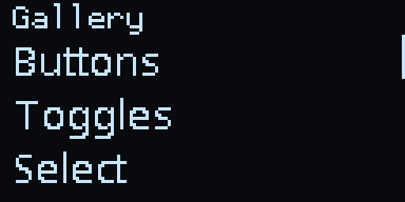

<p align='center'>
  
</p>

<p align='center'><strong>给 TinyGo 用的 GUI 框架，所有会动的东西都由弹簧驱动，按下有反馈，松手才触发。</strong></p>

<p align='center'>
  <a href='https://github.com/chhongzh/lilt/releases' target='_blank'></a>
  <a href='https://pkg.go.dev/github.com/chhongzh/lilt' target='_blank'></a>
  <a href='https://github.com/chhongzh/lilt/actions/workflows/ci.yml' target='_blank'></a>
  <a href='https://github.com/chhongzh/lilt/actions/workflows/docs.yml' target='_blank'></a>
  <a href='LICENSE' target='_blank'></a>
</p>

<p align='center' style='margin-bottom:1rem'>
  <a href='https://chhongzh.github.io/lilt/' target='_blank'></a>
</p>

框架与硬件无关，屏幕和按键都是接口，单色、彩色屏都能接。手感参照 osu!lazer 和 iOS，模块路径是 `github.com/chhongzh/lilt`。上面这张动图由 `go run ./cmd/preview -highlight` 在主机上录制，跑的是和固件同一份 gallery 代码。

## 安装

需要 Go 1.27 及以上，编译到单片机还需要 TinyGo 0.42 及以上。

```sh
go get github.com/chhongzh/lilt@latest
```

> [!WARNING]
> lilt 还在 0.x 阶段，1.0 之前次版本号升级（例如 v0.1 到 v0.2）可能带来不兼容的 API 改动，补丁版本只修 bug。每个版本改了什么写在 [Releases](https://github.com/chhongzh/lilt/releases) 里，升级前先读一遍。

## 文档

完整文档（快速开始、核心概念、组件、接入硬件、API 速查）在 <https://chhongzh.github.io/lilt/>。设计需求见 [DESIGN.md](DESIGN.md)，发布流程见 [RELEASING.md](RELEASING.md)。

## 包

```
lilt      Start、Pause、Stop：启动和停止 UI goroutine
anim      弹簧动画 Value 与全局调度器
gfx       Screen 接口、带裁剪和平移的 Canvas、字体
ui        节点树、布局、页面与弹窗的层栈、焦点、输入、光标、主题
widget    Label、List、Scroll、Button、CheckBox、Radio、Select、Chip、Choice、Toggles、Input、Drawer、Dialog、Toast、软键盘
driver    SH1106、JD9853 驱动；desktop 桌面窗口（也能编成 wasm）；silent 只画进内存、输出图片和 GIF
examples  gallery 演示，以及 ESP32-S3、乐动 v2 的固件
cmd       preview：按脚本回放一段操作，输出 GIF 和截图拼图
          sim：在桌面窗口或浏览器里跑 gallery
```

除了 `driver`，这些包都不 import `machine`，主机上可以直接编译和预览。

## 硬件支持

实现了 `gfx.Displayer`（方法签名与 `tinygo.org/x/drivers` 的 `Displayer` 一致）的驱动，用 `gfx.FromDisplayer` 包一层就能用：

```go
dev := ssd1306.NewI2C(machine.I2C0)
dev.Configure(ssd1306.Config{Width: 128, Height: 64})
lilt.Start(gfx.FromDisplayer(dev), home)
```

带帧缓冲的单色屏最合适，下面的驱动可以直接用；彩色屏需要自己加帧缓冲才不闪，墨水屏适合静态菜单。完整的驱动清单、写适配器和 `gfx.Inverter`（反色光标）见[接入硬件](https://chhongzh.github.io/lilt/guides/hardware/)。

> **除了 [examples/esp32s3-generic](examples/esp32s3-generic) 里的 SH1106 实测过，其余组合都没有在真机上测试。**

仓库内自带 `driver/sh1106` 和 `driver/jd9853`（[examples/ledong-v2](examples/ledong-v2)，在乐动 v2 上测过）。

## 在桌面上试

没板子也能玩：`driver/desktop` 用 [Ebitengine](https://ebitengine.org) 开窗口当屏幕，键盘当按键，不需要 cgo。

```sh
go run ./cmd/sim        # 跑 gallery
```

WASD 或方向键移动，空格或回车是 OK，J 是 Back，K 是 Menu。同一份代码也能编成 wasm 在浏览器里跑，做法见[驱动与模拟器](https://chhongzh.github.io/lilt/guides/drivers/)。

## 构建

```sh
gofmt -l anim gfx ui widget examples cmd
go vet . ./anim ./gfx ./ui ./widget ./driver/desktop ./driver/silent ./examples/gallery ./cmd/preview ./cmd/sim
tinygo build -target esp32s3-generic -o /tmp/gallery.bin ./examples/esp32s3-generic
```

`go build ./...` 会因为 `driver/sh1106`、`driver/jd9853` 依赖 `machine` 而失败，主机上请按包名单独编译。

## 贡献

欢迎提交 Pull Request，请基于 `dev` 分支。`main` 只放已发布的版本。

## 许可证

lilt 以 MIT [LICENSE](LICENSE) 发布。文档站点同样基于 MIT 发布。
