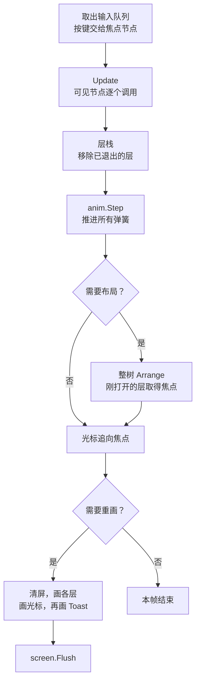

# 核心概念

lilt 的界面是一棵节点树，由一个 UI goroutine 独占：它每帧处理按键、推进动画、在属性变化后整树重排，再把整屏画一遍。下面几页分别讲这条流水线上的一环，写复杂界面之前建议按顺序读一遍。

| 页面 | 讲什么 |
| --- | --- |
| [节点树](tree.md) | `Node` 和 `Box`、用选项嵌套建树、增删节点、节点靠哪些接口获得能力 |
| [布局](layout.md) | 尺寸、锚点、`Stack`、`Flex`、`Grid`，以及位置变化时的滑动 |
| [主题与单位](theme.md) | `Theme` 的字段和默认值、单位如何随字体缩放、光标的弹簧 |
| [线程模型](threading.md) | 回调为什么不在 UI goroutine 上、`ui.Do` 和 `widget.Control` |
| [输入与焦点](input.md) | 按键的阶段、激活规则、焦点怎么移动、按键怎么分发 |
| [动画](animation.md) | `anim.Value`、`anim.Spring` 和几个预设 |
| [页面与弹窗](layers.md) | 层栈、`ui.Push` 的页面、`ui.Open` 的抽屉、对话框和 Toast |

## 一帧里发生什么

`lilt.Start` 起的 goroutine 循环调用帧，帧率上限是 `lilt.FPS`（默认 60），传给各处的 `dt` 是距上一帧的秒数，最多按 0.1 秒算，卡顿之后动画不会一步跳到终点。一帧从头到尾持有一把锁，`ui.Do` 就是在两帧之间拿这把锁，所以它里面的代码不会和帧交错执行。

- 收到按键、有弹簧还在动，都会把这一帧标成需要重画；什么都没变的帧不画也不 `Flush`，屏幕总线是空闲的。
- 布局只在调用过 `ui.Relayout()` 之后做，任何影响尺寸和位置的 Set 方法都会调用它，见[布局](layout.md#relayout)。
- 光标画在页面和弹窗之上、Toast 之下，所以聚焦的行不会把 Toast 反色。
