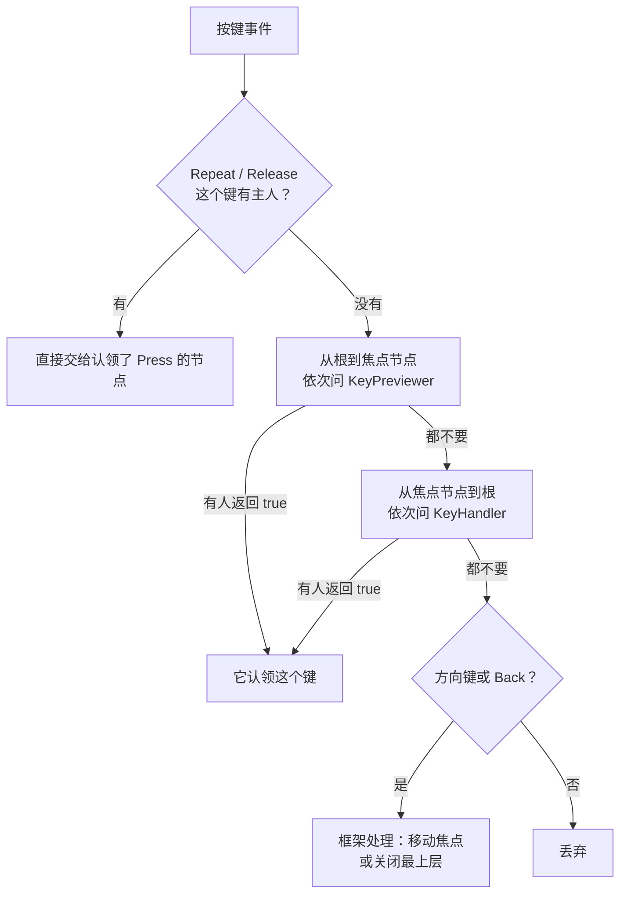

# 输入与焦点

lilt 为只有几个按键的设备设计：方向键移动焦点，++ok++ 激活，Back 键返回。屏幕上始终有一个光标标出焦点，它对每个按键都有反馈。触摸和鼠标也接入同一套规则，在内部被翻译成对 ++ok++ 的按下和松开。

```go
import "github.com/chhongzh/lilt/ui"
```

## 按键与阶段 { #keys }

`ui.Key` 是逻辑键，引脚或扫描码怎么映射到它由板子代码决定（见[接入硬件](../guides/hardware.md#keys)）：

| 键 | 框架的用法 |
| --- | --- |
| `KeyUp`、`KeyDown`、`KeyLeft`、`KeyRight` | 没有节点认领时移动焦点；`k.Arrow()` 对这四个返回真 |
| `KeyOK` | 激活焦点组件 |
| `KeyBack` | 没有节点认领时关闭最上层的页面或弹窗，见[返回键](layers.md#back) |
| `KeyMenu` | 框架不使用，留给应用 |
| `KeyBackspace` | `Input` 删除一个字符 |
| `KeyChar` | 带一个字符，字符在 `KeyEvent.Rune` 里 |

每个键经历三个阶段 `ui.Phase`：

| 阶段 | 中文 | 什么时候 |
| --- | --- | --- |
| `Press` | 按下 | 键刚按下 |
| `Repeat` | 连发 | 按住不放时周期性产生，由 [`KeyPoller`](#keypoller) 生成 |
| `Release` | 松开 | 键抬起 |

组件收到的是 `*ui.KeyEvent`：

```go
type KeyEvent struct {
	Key      Key
	Phase    Phase
	Rune     rune // KeyChar 的字符
	Canceled bool // 这次松开不能触发动作：触摸变成了拖动
	Repeated bool // 松开之前有过连发，动作已经在连发时做过了
}

func (e *KeyEvent) Fires() bool // 这个事件是否该执行按键的动作
```

## 激活规则 { #activation }

**按下只给反馈，松开才执行。** 所有可激活的组件都在 `KeyOK` 的 `Release` 且 `!Canceled` 时触发；`Press` 只认领这个键、让光标收缩。这和 iOS 一样：按下去发现按错了，还来得及在松手前把手指拖走（触摸屏）或者让组件取消，例如 [长按确认](../widgets/button.md#长按确认) 的按钮中途松手什么也不做。

方向键和 Back 也遵守同一条规则：按下时光标先朝那个方向探一下，松开时焦点才真的移动、页面才真的关闭。

{ .demo }

动图里先按住 ++arrow-down++：光标朝下靠了 2 像素，焦点没动；松开后焦点落到下一行。再按住 ++ok++：光标收缩；松开后方框才勾上。

`e.Fires()` 把这条规则写成了一个判断，自己写组件处理按键时用它：

- `Release` 且没有 `Canceled`、之前没有过连发：执行；
- `Repeat`：每次都执行，所以按住方向键可以连续移动；
- `Press`：不执行。

按住 ++arrow-down++ 不放时，焦点随每次连发下移；最后那次松开带着 `Repeated`，`Fires()` 返回假，焦点不会再多走一格。

{ .demo }

!!! note "OK 的连发"
    组件是否响应 `KeyOK` 的连发由组件自己决定。标准组件都只在松开时触发，按住 ++ok++ 不会反复点击。

## 产生按键 { #keypoller }

最直接的办法是在任何 goroutine 上调用 `ui.Emit(key, phase)`。它只是把事件放进队列，UI goroutine 在下一帧开头统一处理；队列满（32 个）时新事件被丢掉，不会阻塞调用者。

```go
func Emit(k Key, p Phase)                     // 按键事件
func EmitRune(r rune)                         // 一个字符，以 KeyChar 的 Press 送达
func EmitPointer(x, y int16, p PointerPhase) // 触摸或鼠标，屏幕像素坐标
```

接的是机械按键时，用 `ui.KeyPoller` 把引脚电平变成干净的事件。在读引脚的循环里，每个键每次采样调用一次 `Poll`，`dt` 是距上次采样的秒数：

```go
func pollKeys(read func(ui.Key) bool) {
	p := ui.NewKeyPoller()
	keys := []ui.Key{ui.KeyUp, ui.KeyDown, ui.KeyOK, ui.KeyBack}
	for {
		for _, k := range keys {
			p.Poll(k, read(k), 0.005)
		}
		time.Sleep(5 * time.Millisecond)
	}
}
```

它用轮询而不是中断，按键抖动在采样层面就被滤掉了。字段都可以在 `NewKeyPoller` 之后直接改：

| 字段 | 默认值 | 含义 |
| --- | --- | --- |
| `Debounce` | 2 | 连续多少个相同的采样才承认电平变化 |
| `RepeatDelay` | 0.2 | 按住多少秒后开始连发 |
| `RepeatInterval` | 0.07 | 第一次连发的间隔，秒 |
| `Accel` | 0.9 | 每连发一次，间隔乘以它，越按越快 |
| `MinInterval` | 0.03 | 间隔的下限，秒 |

`KeyPoller` 内部没有加锁，同一个实例只在一个 goroutine 上调用 `Poll`。

## 分发路径 { #dispatch }

UI goroutine 每帧开头取空队列，按键按下面的路径交给节点：



两个接口：

```go
type KeyPreviewer interface{ PreviewKey(e *KeyEvent) bool } // 自上而下，先于焦点节点
type KeyHandler interface{ HandleKey(e *KeyEvent) bool }    // 自下而上冒泡
```

- **认领**：在 `Press` 时返回 `true` 的节点成为这个键的主人，之后的 `Repeat` 和 `Release` 不再走路径，直接交给它，即使焦点在这期间移走了。反过来，`Press` 时不认领，就收不到 `Release`：一个只想在松开时做事的组件，也必须在 `Press` 时返回 `true`。标准组件对 `KeyOK` 的所有阶段都返回 `true`。
- **预览**：`KeyPreviewer` 让容器在子节点之前截住按键，例如一个想自己处理方向键的面板。
- **框架兜底**：没人认领的方向键交给焦点移动（下一节），没人认领的 Back 交给[层栈](layers.md#back)。组件认领了方向键或 Back，框架就不再处理它们。

`KeyOK` 无论谁认领，按下和松开都会让光标收缩和回弹。

## 焦点 { #focus }

任何时刻最多一个节点有焦点，它必须可聚焦（`SetFocusable(true)` 或选项 `ui.Focusable()`）并且可见。焦点只在最上层的页面或弹窗里移动。

```go
func SetFocus(d Node)                    // 把焦点交给 d；d 不可聚焦或被隐藏时什么也不做
func Focused() Node                      // 当前焦点，没有时为 nil
func FirstFocusable(d Node) Node         // d 的子树里按树的顺序第一个可聚焦节点
func FindFocus(scope, from Node, dir Key) Node // 从 from 往 dir 方向，scope 里下一个焦点
func RestRect(d Node) Rect               // d 动画落定后在屏幕上的矩形
```

### 方向键怎么选下一个

`FindFocus` 照搬 Android 的 FocusFinder：

1. 只有朝按键方向超出源节点的节点才是候选：按右键时，候选的左右两条边都要比源节点的更靠右。
2. 和源节点在同一条“光束”里的候选优先：按左右键时纵向有重叠，按上下键时横向有重叠。
3. 剩下的比较 `13·主轴距离² + 次轴距离²`，最小的胜出。主轴是按键的方向，系数 13 和 Android 相同，让沿按键方向的距离比偏离的距离重要得多。

距离都用 `RestRect` 算，也就是动画落定后的位置。快速连按时，列表还在滑动、页面还在飞入，焦点仍然按最终布局走，不会被半路的位置带偏。

{ .demo }

```go
--8<-- "cmd/docgif/demo_input.go:input-focus"
```

网格里不需要任何焦点代码：按钮默认可聚焦，方向键按几何位置找邻居。

### 焦点什么时候自己变

- 打开页面或弹窗：新层第一次布局后，焦点给它的 `FirstFocusable`。打开后立刻 `SetFocus` 的节点会被保留，`Select` 就是这样让抽屉一打开就停在当前选项上。
- 关闭页面或弹窗：焦点回到打开它之前的那个节点。
- 焦点节点被移除或隐藏：焦点移到同一层里中心离它最近的可聚焦节点。
- 没有焦点时按方向键：焦点给当前层的 `FirstFocusable`。

### 相关接口

| 接口 | 谁实现 | 作用 |
| --- | --- | --- |
| `Focuser` | 想知道自己得失焦点的节点 | 得到和失去焦点时调用 `FocusChanged(focused bool)` |
| `Revealer` | 滚动容器 | 某个后代得到焦点时 `Reveal(d)` 被调用，把它滚进视野 |
| `ArrowScroller` | 滚动容器 | 焦点移动之前，焦点节点的祖先自下而上被问 `ArrowScroll(e, next)`；`next` 是将要去的节点，到边上时为 `nil`。返回 `true` 就吃掉这个键 |

`ArrowScroller` 是 [`Scroll`](../widgets/scroll.md) 的工作方式：内容里没有可聚焦的东西时直接滚动，滚到头了往回顶一下，[嵌套](../widgets/scroll.md#nested)时把键让给外层。实现它时注意：只有 `Fires()` 的事件可以真的移动东西；`Press` 时可以表示已经到头；不 `Fires()` 的 `Release` 会发给每一层滚动容器让它们复位，这时必须返回 `false`。

## 光标 { #cursor }

光标是全局唯一的高亮，标出焦点节点。它住在屏幕坐标里，属于整个界面而不是某个页面，所以换页面时它不会消失，而是跳过去。

| 动作 | 光标的反应 | 弹簧 |
| --- | --- | --- |
| 焦点移动 | 四条边各自动画：朝移动方向的边先到，对面的边慢一些跟上，于是先拉长再收拢 | `ui.CursorLead`、`ui.CursorTrail` |
| 按住方向键 | 朝那个方向靠 2 像素，松开回来 | `ui.CursorLean` |
| 按下 ++ok++ | 左右各收 3 像素、上下各收 1.5 像素，不回弹 | `anim.Interactive` |
| 松开 ++ok++ | 带一点晃动弹回原样 | `ui.CursorRelease` |
| 按住 Back | 跟着被探出的页面或弹窗一起移动 | `ui.CursorLean` |
| 打开或关闭页面、弹窗 | 跳起约 3 像素，同时左右各放大约 2 像素，落地时压扁一下 | `ui.CursorLeap` |
| 出现、消失 | 从目标中心长出来，缩回中心消失 | `ui.CursorLead`、`ui.CursorTrail` |

这些弹簧是 `ui` 包里的指针变量，改它们的字段就能全局调整光标手感，默认值见[主题](theme.md#theme)。

光标的画法取决于屏幕：实现了 `gfx.Inverter` 的屏幕（SH1106 这类单色屏），光标把圆角矩形里的像素反色；不能反色的屏幕画一个主题 `Accent` 颜色的圆角边框。圆角取主题的 `Radius`。焦点节点在裁剪容器里只露出一部分时，光标只盖住露出来的部分。

焦点节点实现 [`ui.CursorShaper`](../guides/custom-widget.md#cursorshaper) 可以改光标的矩形，长按确认按钮就是这样把光标一点点吃掉的。

## 触摸与鼠标

`ui.EmitPointer(x, y, phase)` 送来的指针事件按下面的规则翻译：

| 指针 | 效果 |
| --- | --- |
| `PointerDown` | 点中节点所在的最近一个可聚焦祖先得到焦点，并收到一次 `KeyOK` 的 `Press` |
| `PointerMove`，按着 | 移动超过 4 像素后，从点中的节点往根问 `PointerHandler`，返回 `true` 的节点捕获指针，之后的移动都交给它；同时补发一次带 `Canceled` 的 `KeyOK` 松开，组件不会被激活 |
| `PointerMove`，没按 | 悬停：指针下的可聚焦节点得到焦点，光标朝指针偏一点（最多 3 像素） |
| `PointerUp` | 没有被拖动取消时，补发 `KeyOK` 的 `Release`，组件被激活 |

```go
type PointerHandler interface{ HandlePointer(e *PointerEvent) bool }
```

所以组件不需要为触摸写任何代码：它们只处理 `KeyOK`，点一下就是按下加松开，拖动就是被取消的按下。`Scroll` 实现了 `PointerHandler`，拖动列表时它捕获指针并滚动。按方向键会让光标停止跟随指针。
