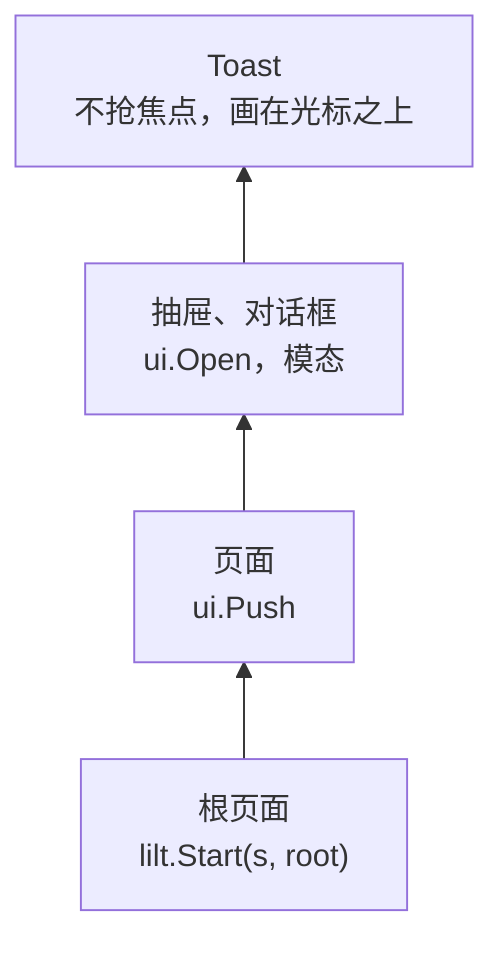

# 页面与弹窗

屏幕上的东西分层叠放：最底下是 `lilt.Start` 推入的根页面，上面是 `ui.Push` 推入的页面和 `ui.Open` 打开的弹窗。这些层按绘制顺序排成一个层栈，进出的动画、焦点的保存和恢复、Back 键都由层栈统一处理，组件不需要自己管。

```go
import "github.com/chhongzh/lilt/ui"
```

```go
func Push(p Node)           // 推入一个全屏页面
func Open(n Node, p Popup)  // 打开一个弹窗
func Pop() bool             // 关闭最上层的页面或弹窗；根页面不关，返回 false
func Close(n Node) bool     // 关闭显示 n 的那一层
```

四个函数都要在 UI goroutine 上调用，回调里就包在 [`ui.Do`](threading.md#do) 里。



只有最上面的模态层接收焦点、按键和指针。Toast 不是模态的，它永远不拿焦点。

## 页面 { #push }

`ui.Push(p)` 把 `p` 作为新的一屏推入：它从右边滑进来，下面的页面同时往左退到 -1/3 屏宽处。关闭时反过来。

{ .demo }

```go
--8<-- "cmd/docgif/demo_layers.go:layers-push"
```

`display` 和 `brightness` 是构造函数而不是现成的节点：每次进入都新建一页，关闭后整页被丢掉，下次进来又是新的状态。一个节点同一时间只能有一个父节点，已经关掉的页面不能再推入一次。

- 页面铺满整屏，[锚点](layout.md#anchor)和尺寸对页面的根节点不起作用。
- 被上面的页面完全盖住的页面会被隐藏，既不画也不跑 `Update`。按住 Back 让上层页面探出一点时，下层页面重新露出、恢复绘制。
- 页面进出用 `anim.Smooth` 弹簧，光标同时跳到新页面上（见[光标](input.md#cursor)）。
- 根页面不能被关闭，`ui.Pop()` 在只剩根页面时返回 `false`。

## 弹窗 { #popups }

`ui.Open(n, kind)` 把 `n` 放进一个由层栈画的框里。`kind` 决定位置和进出方向：

| `ui.Popup` | 位置与大小 | 进出 |
| --- | --- | --- |
| `DrawerBottom` | 贴底边，横向铺满，高度按内容 | 从下边滑入 |
| `DrawerTop` | 贴顶边，横向铺满，高度按内容 | 从上边滑入 |
| `DrawerLeft` | 贴左边，纵向铺满，宽度按内容 | 从左边滑入 |
| `DrawerRight` | 贴右边，纵向铺满，宽度按内容 | 从右边滑入 |
| `Dialog` | 屏幕正中，大小按内容，离屏幕边至少 4 个单位 | 从上方落下，带一点回弹 |
| `Toast` | 底部居中，大小按内容，离边 4 个单位 | 从下边升起 |

{ .demo }

```go
--8<-- "cmd/docgif/demo_layers.go:layers-popups"
```

菜单项的回调先 `ui.Close(menu)` 再 `widget.Toast(...)`，两步放在同一个 `ui.Do` 里，同一帧生效。和页面一样，弹窗的内容每次打开都新建：关闭的弹窗内容仍然挂在旧的层上，再 `Open` 同一个节点会 panic。

大多数时候直接用 `widget` 里的封装就够了：带标题的 [`Drawer`](../widgets/popups.md#drawer)、带按钮的 [`Dialog`](../widgets/popups.md#dialog)、一行字的 [`Toast`](../widgets/popups.md#toast)。它们内部也是调用 `ui.Open`。

### 边框与内边距

弹窗的背景、边框和内边距都由层栈负责：

- 层栈先用主题 `Background` 填满框，再用 `Foreground` 描边，圆角取 `Radius`。抽屉的框伸出贴着的那条屏幕边，只露出里侧的两个圆角，圆角按两倍画。
- 框和内容之间留主题的 `PanelPadding`，抽屉贴边的那一侧不留。
- 框的大小是内容加内边距，但不会超出可用空间。

所以弹窗的内容自己不要再加边框和内边距，上面的菜单就是一个光秃秃的 `ui.NewColumn()`。

### 焦点

模态层打开时，层栈记下当前焦点，清空焦点，等新层第一次布局之后把焦点交给它的第一个可聚焦节点；打开之后立刻 `ui.SetFocus` 的节点会被保留。模态层关闭时，焦点回到记下的那个节点。动图里关掉菜单后，光标回到了 `Actions` 上。

Toast 不参与这些：它不拿焦点、不接按键，层栈把它画在光标之上，聚焦的行不会把 Toast 反色。

## 返回键 { #back }

没有节点认领的 `KeyBack` 交给层栈，和其他按键一样按下给反馈、松开才执行：

| 时机 | 最上层是页面或弹窗 | 最上层是根页面 |
| --- | --- | --- |
| 按下 | 往它离开的方向探出 8 像素，光标跟着移动 | 只探出 4 像素 |
| 松开 | 关闭 | 弹回原位，再往右顶一下，光标同样被顶一下 |
| 松开但 `Canceled` | 弹回原位，不关闭 | 弹回原位 |

{ .demo }

按下时的探出让用户在松手前看到将要发生什么：页面往右挪、露出下面那一页，抽屉往它的边缩回去，对话框往上提。在根页面上没有可返回的地方，那一下“顶”告诉用户这里已经到头。

组件在 `Press` 时认领了 `KeyBack`（`HandleKey` 返回 `true`），层栈就收不到它，见[分发路径](input.md#dispatch)。想在关闭前确认，例如“放弃未保存的修改？”，就在页面的根节点上认领 Back，自己决定什么时候 `ui.Pop()`。

!!! tip "代码里关闭"
    `ui.Pop()` 关闭最上面的模态层，不管它是页面还是弹窗；`ui.Close(n)` 关闭显示 `n` 的那一层，不一定在最上面。两者都返回是否真的关了：根页面、已经在退出的层、不在栈里的节点都返回 `false`。
