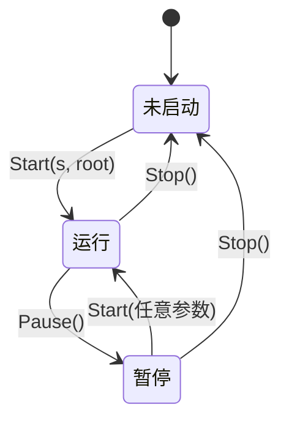

# 线程模型

lilt 只有一个 UI goroutine，它独占节点树：处理按键、推进动画、布局、绘制都在它上面。用户的 `OnClick`、`OnChange` 回调则相反，每次都在一个新的 goroutine 上跑，慢回调不会让动画卡住一帧。两边之间只有一座桥：`ui.Do`。

```go
import (
	"github.com/chhongzh/lilt"
	"github.com/chhongzh/lilt/ui"
	"github.com/chhongzh/lilt/widget"
)
```

## 生命周期 { #lifecycle }

`lilt` 包只有三个函数和一个变量，都可以在任何 goroutine 上调用：

| 标识符 | 作用 |
| --- | --- |
| `lilt.Start(s, root)` | 绑定屏幕 `s`，把 `root` 作为第一个页面推入（`root` 为 `nil` 时不推），启动 UI goroutine |
| `lilt.Pause()` | 停止更新和绘制，状态原样保留 |
| `lilt.Stop() error` | 结束 UI goroutine，丢掉所有页面和弹窗，返回让帧循环提前结束的错误 |
| `lilt.FPS` | 帧率上限，默认 60，每帧都重新读取 |



板子上的 `main` 一般是这样：先建好树，`Start`，然后主 goroutine 去读引脚，或者用 `select {}` 挂住。

```go
func run(screen gfx.Screen, home ui.Node) {
	lilt.Start(screen, home) // 从这里起，树归 UI goroutine
	select {}
}
```

几个从代码里确认的细节：

- `Start` 只在未启动时生效。已经在运行时再调用什么也不做；暂停时调用会恢复运行，传入的参数被忽略。
- 暂停期间按键照样进输入队列，恢复后再处理。队列能放 32 个事件，满了之后新来的直接丢掉，读按键的 goroutine 永远不会被阻塞。
- 帧之间传给动画的 `dt` 最多按 0.1 秒算，卡顿或暂停之后动画不会一步跳到终点。
- `screen.Flush` 返回错误时帧循环自己结束，错误留给下一次 `Stop` 返回。`Stop` 之后可以用新的屏幕和根节点重新 `Start`。

一帧里各步骤的顺序见[核心概念](index.md#一帧里发生什么)。

## 谁在哪个 goroutine 上跑

| 代码 | 运行在 |
| --- | --- |
| 组件实现的接口：`Update`、`Draw`、`HandleKey`、`Measure`、`FocusChanged`、`CursorShape` 等 | UI goroutine |
| `ui.TextTarget`、`ui.TextInputMethod` 的实现 | UI goroutine |
| `OnClick`、`OnChange` 回调 | 每次激活一个新的 goroutine |
| `ui.Do` 的参数 | 调用者的 goroutine，但持有帧锁，帧不会同时进行 |
| `ui.Emit`、`ui.EmitRune`、`ui.EmitPointer`、`lilt.Start`/`Pause`/`Stop` | 任意 goroutine |

`lilt.Start` 之前树还不属于任何人，在哪里建都可以。之后，除了 UI goroutine 自己，谁要改树、改组件属性、开关页面，都得包在 `ui.Do` 里。

## ui.Do { #do }

`ui.Do(fn)` 等到两帧之间，拿到帧锁，在调用者自己的 goroutine 上执行 `fn`，返回时 `fn` 已经跑完。一帧从输入到 `Flush` 全程持有这把锁，所以 `fn` 里看到的树不会跑到一半，改动在下一帧一起生效。

{ .demo }

```go
--8<-- "cmd/docgif/demo_threading.go:threading-do"
```

回调里的 `time.Sleep` 占的是回调自己的 goroutine，这一秒里列表照常滚动、光标照常动画；超过 150ms 后行尾出现加载点（见[下一节](#control)）。只有最后改文字的那一句需要 `ui.Do`。

!!! warning "`ui.Do` 不能嵌套，也不能在 UI goroutine 上调用"
    帧锁是普通的 `sync.Mutex`，不可重入。`fn` 里再调用 `ui.Do` 会死锁；在 `HandleKey`、`Update`、`Draw` 这些本来就在 UI goroutine 上、本来就持有锁的地方调用，同样会死锁。这些地方直接改树即可。

几条实用的规则：

- `fn` 要短。它执行期间下一帧在等，不要在里面 `Sleep` 或等网络，把慢的部分放在 `ui.Do` 外面。
- 相关的改动放进同一个 `ui.Do`。分成两次调用，中间可能插进一帧，屏幕上会出现只改了一半的状态。
- 回调之间共享的变量也可以靠 `ui.Do` 保护：所有 `fn` 在同一把锁下串行执行。
- 暂停或还没 `Start` 时没有帧持锁，`ui.Do` 立即执行；暂停期间的改动在恢复后的第一帧显示出来。

## 回调与 widget.Control { #control }

所有可交互的组件都嵌入了 `widget.Control`，`OnClick`、`OnChange`、加载状态、失败回滚都由它统一处理。设置回调有两种写法，效果一样：

```go
saves := 0
save := widget.NewButton("Save", widget.OnClick(func() { saves++ })) // 构造时用选项
save.OnClick(func() error { return errors.New("disk full") })         // 之后用方法，替换掉上面那个
```

`OnClick` 和 `OnChange` 是 `Control` 上的泛型方法，同名的 `widget.OnClick`、`widget.OnChange` 是对应的选项。选项按能力匹配，作用于任何嵌入了 `Control` 的节点；`RadioGroup` 不是节点，只能用方法 `g.OnChange(...)`。

### 回调的类型

`OnClick` 接受 `widget.ClickFunc` 约束里的两种函数：

| 类型 | 用途 |
| --- | --- |
| `func()` | 不会失败的动作 |
| `func() error` | 返回非 `nil` 表示失败，组件抖一下 |

`OnChange` 接受 `widget.ChangeFunc`，参数是旧值和新值，值的类型由组件决定，同样可以带 `error` 返回值：

| 组件 | 回调类型 | 不触发 `OnChange` 的 Set 方法 |
| --- | --- | --- |
| [`CheckBox`](../widgets/toggle.md#checkbox) | `func(from, to bool)` | `SetChecked` |
| [`RadioGroup`](../widgets/toggle.md#radio) | `func(from, to int)` | `Select` |
| [`Select`](../widgets/select.md) | `func(from, to int)` | `SetSelected` |
| [`Choice`](../widgets/chips.md#choice) | `func(from, to int)` | `Choose` |
| [`Toggles`](../widgets/chips.md#toggles) | `func(from, to uint32)`，第 i 位是第 i 个 Chip | `SetOn`、`SetMask` |
| [`Input`](../widgets/input.md) | `func(from, to string)` | `SetText` |

回调类型和组件不匹配时，`OnChange` 在设置的那一刻 panic，例如给 `CheckBox` 传 `func(from, to int)`，或者给没有值的 `Button` 设 `OnChange`。

### 执行顺序

一次激活里，`OnChange`（值确实变了才有）先跑，返回 `nil` 之后再跑 `OnClick`，两者在同一个 goroutine 上依次执行。`OnChange` 返回错误时 `OnClick` 不再执行。值没变的激活只跑 `OnClick`，例如在 `Select` 里重新选了原来那一项。

值类组件是乐观的：激活的那一帧就显示新值，回调在后台确认。

`Choice`、`Toggles` 和 `RadioGroup` 虽然也嵌入了 `Control`，但它们只报告 `OnChange`，设在它们身上的 `OnClick` 不会被调用。要响应“点了某一项”，把 `OnClick` 设在单个 `Radio` 或 `Chip` 上，`Radio` 的 `OnClick` 跑在组的 `OnChange` 之后。

### Busy、Loading 与失败

{ .demo }

```go
--8<-- "cmd/docgif/demo_threading.go:threading-rollback"
```

`Cloud sync` 的回调一秒后失败：先出加载点，然后行左右抖一下，方框退回未勾选。`Vibrate` 的回调 50ms 就返回，画面上只有方框的翻转。

| 状态 | 判定 | 表现 |
| --- | --- | --- |
| Busy | 回调已开始、还没返回，`Busy()` 为真 | 组件忽略新的激活，外观不变 |
| Loading | Busy 超过 150ms，`Loading()` 为真 | 按钮的文字、行尾的控件、Chip 的横条换成跳动的加载点 |
| 成功 | 返回 `nil` | 回到正常；按钮如果显示过加载点，先亮一个勾 |
| 失败 | 返回 `error` | 组件抖一下；值类组件恢复旧值，按钮显示叉 |

150ms 的门槛（`widget/control.go` 里的 `loadingDelay`）是为了让很快的回调不闪一下加载点。回调返回后，状态的收尾通过 `ui.Do` 回到 UI goroutine 上做，所以回滚和 Set 一样不会再触发 `OnChange`。抖动是给组件的 `OffsetX()` 一个 -260 像素/秒的初速度，弹簧见[动画](animation.md#value)。

!!! warning "代码里 Set 不触发 `OnChange`"
    `OnChange` 只报告用户的改动。代码里调用 `SetChecked`、`SetText` 这些方法改值，回调不会被调用，这样回滚、从存储里恢复设置都不会引起回调循环。需要同时处理两种来源时，把逻辑写成一个函数，Set 之后自己调用它。

各组件的状态细节见各自的页面，例如 [Button](../widgets/button.md) 的勾和叉会停留 1.2 秒。
